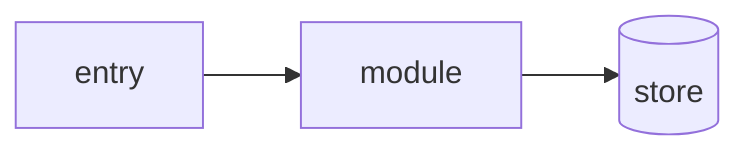

# Project Context

Living snapshot of the project's verified state. Replace stale facts; never append history.

_Last verified: YYYY-MM-DD_

## Verified Stack

| Field | Value |
| --- | --- |
| Runtime/language | [runtime and version] |
| Framework | [framework, or `none`] |
| Package manager | [package manager] |
| Database | [database and version, or `none`] |
| Cache/queue | [cache or queue product, or `none`] |
| Frontend | [frontend stack, or `none`] |
| Build/test commands | [`build command`, `test command`] |
| Deployment/container | [how this ships] |

## Application Flow

Two views of the same application. Per-feature detail belongs in `docs/specs/` and `docs/plans/`.

### User Flow

What a person does, start to end, one line per main journey (role in brackets). Only journeys the code actually implements.

- [role] `[screen or action]` → `[screen or action]` → `[outcome]`: when this happens

`none` when the repository has no user-facing flow yet.

### System Flow

Cross-module paths only: entry point → module → where state lands or which external system is called.

- `[entry]` → `[module]` → `[store/service]`: what triggers it
- `[entry]` → `[module]` → `[external service]`: what triggers it

`none` when nothing in this repository crosses a module boundary — docs-only, library, or tooling repo.

### Flow Diagram

One mermaid flowchart mirroring the System Flow list: same paths, nothing internal.

`none` when the list is `none`.

## Modules & Access

Only what the repository shows. `none` for a row the project does not have; never a guess.

- Modules: `[module name]` in `[folder]` — one line per business module
- Authentication: [mechanism and where it is enforced (middleware, guard, filter), or `none`]
- Roles: [the roles the code defines and what each may do, or `none`]
- Approval chain: [who submits, who approves, limits, or `none`]

## Environments & Jobs

- Environments: [local / dev / UAT / prod as the config defines them; which database each points to; the agent touches only local, or `none`]
- Scheduled jobs and workers: [cron, queue workers, batch runs with their trigger, or `none`]

## Architecture Notes

Module boundaries and who owns what.

## Important Integrations

External systems this project talks to, and where the client lives.

## Conventions

Project rules an agent must follow that the code does not make obvious.

- Data classification: [`regulated` (banking, finance, personal data: `rules/security.md` controls apply) or `standard`]

## Known Constraints

Operational limits, deliberate tradeoffs, and things that must not be "fixed".

> Do not store secrets, tokens, passwords, or private credentials here.
