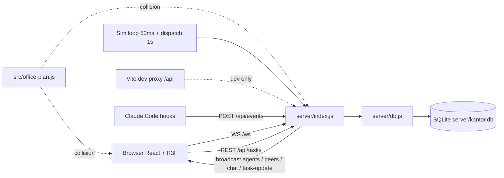

# Project Context

Living snapshot of the project's verified state. Replace stale facts; never append history.

_Last verified: 2026-11-11_

## Verified Stack

| Field | Value |
| --- | --- |
| Runtime/language | Node.js 22.22.2, JavaScript (ESM, `"type": "module"`), no TypeScript |
| Framework | Backend: Express 5.3.0 + ws 8.22.1 (`server/index.js`); Frontend: React 19.3.1 + Vite 8.3.6 |
| Package manager | npm 10.9.7 (`package-lock.json`) |
| Database | SQLite via better-sqlite3 12.11.1, file `server/kantor.db` (WAL mode, gitignored); schema created with `CREATE TABLE IF NOT EXISTS` in `server/db.js`, no migrations |
| Cache/queue | none |
| Frontend | React 19 + @react-three/fiber 9.8.2 + @react-three/drei 10.7.9 + three 0.187.0 (3D office scene), plain CSS with tokens in `src/index.css`, Nunito via `@fontsource-variable/nunito` (self-hosted), lint with oxlint |
| Build/test commands | `npm start` (backend, `node server/index.js`), `npm run dev` (Vite dev server, proxies `/api` to port 3000; WebSocket langsung ke port 3000, tanpa proxy), `npm run build`, `npm run lint`, `npm test` (`node --test server/*.test.js`: antrian dan pemulihan task di SQLite memori, parser hook) |
| Deployment/container | none; in production Express serves `dist/` statically from the same process (`PORT` env, default 3000) |

## Application Flow

Two views of the same application. Per-feature detail belongs in `docs/specs/` and `docs/plans/`.

### User Flow

What a person does, start to end, one line per main journey (role in brackets). Only journeys the code actually implements.

- [pemain] buka halaman → dapat nama tersimpan di `localStorage` (atau acak `kamu-NNN`) → jalan dengan WASD/panah → posisi dikirim ke server → pemain lain melihat avatarnya: tiap kali pemain bergerak
- [pemain] kolom Nama di kiri bawah → ganti nama → server memberi suffix `-2` bila bentrok → nama baru tampil di peer lain dan di chat: saat kolom kehilangan fokus atau Enter
- [pemain] koneksi putus → banner "Koneksi ke server putus" → klien mencoba lagi dengan jeda 1s sampai 10s → snapshot baru memulihkan state: saat server restart atau jaringan putus
- [pemain] `TaskForm` di bawah panel kiri (judul + estimasi detik) → task masuk bagian Antrian → agent idle (bukan lead) jalan ke mejanya dan mengerjakan (bagian Sedang dikerjakan, bar progress) → status `review` (bagian Review di panel kanan) → agent `lead` jalan ke ruang meeting dan mereview → bagian Selesai dengan output teks: setiap task baru
- [pemain] panel kiri → hapus task (hanya Antrian dan Selesai) → task hilang, agent yang sedang mengerjakan kembali idle: saat tombol hapus ditekan
- [pemain] `ChatUI` → kirim chat global → semua pemain melihatnya dan 30 pesan terakhir ikut ke pendatang baru → agent idle terdekat membalas dengan kalimat kaleng: tiap pesan
- [pemain] klik avatar agent → `AgentDM` → kirim DM → agent membalas kalimat kaleng sesuai role dan menampilkan bubble: tiap DM
- [pemain] kirim chat global → gelembung chat muncul 5 detik di atas kepala pengirim, di layar semua pemain; agent tidak membalas chat global: tiap pesan
- [pemain] dekat kursi, sofa, meja makan, pingpong, arcade, atau tempat pakai lain → petunjuk "F untuk duduk" di dok → F memakai tempat itu (duduk, main) dan pose serta arah hadap terlihat pemain lain → F atau WASD berdiri: tiap kali menekan F
- [pemain] tombol "Sembunyikan panel" di atas tengah → panel kiri (pekerjaan + form) dan kanan (review, ringkasan, aktivitas, tim) disembunyikan, tombol menampilkan jumlah task aktif; pilihan diingat di `localStorage`: saat tombol ditekan
- [pengamat] panel kanan bagian Aktivitas → log kejadian task dari server (mulai, menyerahkan ke review, menyetujui, task baru, dihapus, keputusan task Claude) dengan jam dan nama karakter; bagian Tim → status tiap agent simulasi (kerja, jalan, senggang) dengan judul task atau aktivitasnya dan jumlah task selesai: terus-menerus
- [pengamat] agent senggang → capek sehabis kerja ke toilet; selain itu istirahat di sofa, main game di kursi santai, main arcade, main pingpong, ngopi, makan di ruang makan, cek papan task, ngeprint, atau baca buku; satu bubble saat berangkat, tanpa ngomong sendiri: terus-menerus selama server hidup
- [pengamat] sesi Claude Code berjalan → hook mengirim event subagent → karakter tamu bertipe subagent masuk lewat pintu, duduk di ruang meeting, bubble mengikuti tool yang dipakai, berkonfeti saat selesai lalu pulang: tiap subagent mulai dan berhenti (hanya bila hook terpasang)
- [pemain] centang "camera bebas (orbit)" → kamera lepas dari pemain (OrbitControls berputar di titik posisi pemain saat dicentang, zoom 2 sampai 70, tidak bisa turun ke bawah lantai); selama mode ini `Player` tidak menarik kamera dan WASD mengikuti arah pandang kamera: saat checkbox diubah

### System Flow

Cross-module paths only: entry point → module → where state lands or which external system is called.

- Browser `src/useKantor.js` WebSocket `/ws` → `server/index.js` (`wss`) → pesan `snapshot` (termasuk riwayat chat dan log kejadian `events`) lalu `agents` / `peers` (tanpa diri sendiri) / `chat` / `event` / `task-update`: saat koneksi dibuka dan tiap perubahan state
- `logEvent` di `server/index.js` (dipanggil dispatcher, sim loop, endpoint task, keputusan task Claude) → ring buffer 40 kejadian di memori → broadcast `event` → `src/Board.jsx` bagian Aktivitas: tiap task berpindah status
- Browser `POST /api/tasks`, `DELETE /api/tasks/:id`, `GET /api/tasks|agents|stats` → `server/index.js` → `server/db.js` → SQLite `server/kantor.db` → broadcast `task-update` → klien fetch ulang `/api/tasks`: saat pemain menambah atau menghapus task
- `server/index.js` sim loop (`setInterval` 50 ms) + dispatcher (1 s) → `dispatch` / `dispatchReview` → `updateTask` di `server/db.js` → SQLite → broadcast `agents` dan `task-update`: terus-menerus selama server hidup
- `server/index.js` dan `src/Avatar.jsx` sama-sama mengimpor `src/office-plan.js` (`clampToRoom`, `resolveObstacles`, `WALL`) untuk collision: tiap tick gerakan agent di server dan pemain di klien
- Claude Code hook `SubagentStart` / `SubagentStop` / `PreToolUse` (HTTP) → `POST /api/events` (hanya dari loopback) → `server/live.js` (`parseHook`) → `liveStart` / `liveTool` / `liveStop` di `server/index.js` → agen `live-*` di Map yang sama dengan agen simulasi → broadcast `agents` → `src/AgentAvatars.jsx`: tiap event hook
- [pengguna lokal] `Sessions` (tombol Sesi Claude) → pilih proyek terdaftar + tugas → `POST /api/sessions` (loopback, token, Host dan Origin lokal) → `server/sessions.js` menjalankan `claude -p` di folder proyek → keluaran stream-json → kartu sesi dan karakter berlabel nama proyek di kantor → Lanjutkan (`--resume`) atau Hentikan: tiap tugas
- [pengguna lokal] `TaskForm` (Dikerjakan oleh: Claude Code + proyek + instruksi) → `POST /api/tasks/claude` → task `todo` bermode `claude` → `dispatchClaude` (tiap detik) membuka sesi lewat mesin sesi dengan subagent kit, instruksi orkestrasi, dan batas biaya → kartu di Sedang dikerjakan menampilkan aktivitas dan subagent yang berjalan, karakter tamu per subagent di kantor → sesi selesai, gagal, atau dihentikan → hasil kerja disimpan sebagai commit di cabang task → bagian "Butuh keputusanmu" di panel kanan → pemilik membuka Detail (hasil dan diff) lalu memilih Setujui (`done`, cabang dibiarkan), Gabungkan (cabang task digabung ke cabang aktif proyek lalu dibuang), Revisi (`--resume` dengan catatan, di cabang yang sama), atau Ulangi (cabang dibuang, kembali ke `todo`, sesi baru): tiap task Claude
- Dev: Vite (`vite.config.js`) proxy `/api` → `localhost:3000`, sedangkan `useKantor.js` membuka WebSocket langsung ke `ws://<hostname>:3000/ws` (`import.meta.env.DEV`); Prod: Express `express.static('dist')`: setiap request halaman

### Flow Diagram

One mermaid flowchart mirroring the System Flow list: same paths, nothing internal.

## Modules & Access

Only what the repository shows. `none` for a row the project does not have; never a guess.

- Modules: `server` in `server/` — Express + ws server, simulasi agent, dispatcher task, REST API, SQLite access (`db.js`), penerjemah payload hook (`live.js`), mesin sesi Claude Code (`sessions.js`), daftar proyek (`projects.js`), pembaca subagent kit dan instruksi orkestrasi (`kit.js`), cabang kerja git per task (`gitwork.js`), perutean agent (`route.js`)
- Modules: `scene` in `src/` — `Office.jsx` (termasuk ruang toilet), `SkyDeco.jsx` (awan), `Humanoid.jsx` (karakter chibi, pose duduk dan mengetik), `props.jsx` (`Box` dan `Ink` bergaris tepi untuk perabot), `Avatar.jsx` (Player), `AgentAvatars.jsx`, `PeerAvatars.jsx`, `ChatBubble.jsx` (bubble agent dan `Said` untuk chat pemain), `Burst.jsx` (konfeti), `toon.js` (bahan toon dan outline bersama), `looks.js` (tampilan tiap karakter), `motion.js` (peredam gerak), `theme3d.js` (warna 3D), `office-plan.js` (denah dan collision, dipakai server juga)
- Modules: `ui` in `src/` — `Board.jsx` (dua panel samping: kiri pekerjaan dengan `TaskForm` di bawahnya, kanan review + `Watch` untuk ringkasan, aktivitas, tim; dialog hasil task), `ChatUI.jsx`, `AgentDM.jsx`, `sfx.js`; gayanya di `src/index.css` (`.side`, `.sec`, lebar panel `--side`). Tidak ada papan Kanban berkolom, minimap, atau teleport.
- Modules: `state` in `src/` — `useKantor.js` (WS + REST client), `interp.js` (interpolasi posisi karakter lain), `useKeyboard.js`
- Modules: `sessions` — `server/sessions.js` (proses `claude -p`), `server/control.js` (penjaga), `server/projects.js` (daftar folder), `src/Sessions.jsx` (panel)
- Authentication: none; nama pemain acak dari klien, server hanya memotong 24 karakter dan menambah suffix bila bentrok
- Roles: none untuk pengguna; agent simulasi punya role `programmer`, `designer`, `qa`, `lead` (seed di `server/db.js`), hanya `lead` yang mereview
- Approval chain: none untuk pengguna; di simulasi, task worker selesai → status `review` → agent `lead` mengubahnya ke `done`

## Environments & Jobs

- Environments: local saja; satu database `server/kantor.db` di sebelah server; env yang dibaca: `PORT` (default 3000), `KANTOR_DB` (path database, `:memory:` dipakai test), `LIVE_LINGER_MS` (lama tamu agen berdiam setelah selesai, default 4000), `KANTOR_PROJECTS` (path daftar proyek, default `server/projects.json`), `KANTOR_CLAUDE_BIN` (program claude, diganti Claude palsu saat uji), `KANTOR_MAX_BUDGET` (batas biaya dalam USD per task Claude, default 2); tidak ada `.env.example`
- Scheduled jobs and workers: in-process `setInterval` di `server/index.js`: sim loop tiap 50 ms (gerak agent, progress task), `dispatch` + `dispatchReview` tiap 1 detik; saat start, `recoverStuckTasks` mengembalikan task `in_progress` ke `todo` (review lead ke `review`); tidak ada cron atau worker terpisah

## Architecture Notes

Module boundaries and who owns what.

- Server adalah sumber kebenaran untuk posisi agent, task, dan daftar peer; klien hanya merender dan mengirim input (posisi pemain, chat, task baru).
- State runtime agent (posisi, state, bubble) hidup di memori server (`Map`) dan hilang saat restart; hanya tabel `agents` dan `tasks` yang persisten.
- Tabel `agents` di-seed sekali saat kosong (5 agent); `server/index.js` menambah enam agent lagi (`prog3`, `prog4`, `prog5`, `designer2`, `designer3`, `qa2`) dengan `INSERT OR IGNORE` tiap start supaya meja kerja terpakai. Kolom posisi meja tidak dipakai; kursi kerja ada di `DESK_SEATS` di `src/office-plan.js`.
- Klien tidak menerima isi task lewat WS; `task-update` hanya sinyal, lalu klien fetch `/api/tasks`.
- Antrian task FIFO: `getTasksByStatus` (id naik) dipakai dispatcher, sedangkan `getTasks` (id turun) hanya untuk tampilan board.
- Server menghitung daftar peer per penerima tanpa entri penerima itu sendiri; klien tidak boleh menyaring nama sendiri. Nama unik diputuskan server dari nama yang diminta klien.
- Kantor hanya satu lantai: tidak ada rooftop, portal, atau level pemain di pesan `player-pos` dan `peers`.
- Koneksi WS wajib punya listener `error` (ada di `server/index.js`); tanpa itu satu frame rusak mematikan proses.
- Agent yang selesai jalan santai kembali idle lewat blok idle di sim loop (`idleWalk`); jangan mengubahnya jadi `working` saat tiba, karena agent tanpa task tidak akan dipilih dispatcher. Titik meja menempel di tepi kotak tabrakan meja, jadi "sudah sampai" memakai `ARRIVE` (0,35), bukan 0,05.
- Agent berjalan lurus dengan `resolveObstacles`, lalu dibantu rute di atas titik koridor tetap (`WAYPOINTS` di `server/route.js`): visibilitas antar titik dihitung sekali (`SEE`, garis bebas dari `OBSTACLES` lewat `free`, jarak minimal 0,25), `route` mencari jalur terpendek (Dijkstra) dari agent ke tujuan, dan `plan` menyusun daftar titik singgah `a.vias` dari titik wajib (`via` tempat duduk, pintu toilet) ditambah jalur koridor di tiap ruas yang terhalang. Rute dihitung ulang saat titik singgah terakhir tercapai dan saat agent tertahan 1,5 detik tanpa bergerak; titik yang sudah di kaki agent dibuang dari rute (tanpa itu agent berputar di titik yang sama). Keluar dari tempat duduk lewat titik masuknya dulu (`a.at.via`). Setelah 30 detik berjalan agent dipindah ke targetnya sebagai jaring pengaman. Tambahkan titik koridor bila ada area baru, dan uji dengan menjalankan agent dari banyak titik acak ke semua tempat (12.000 percobaan tanpa macet saat ini).
- Denah: dua kelompok masing-masing dua pasang baris meja saling membelakangi dengan sekat tengah dan antar meja (`CLUSTER_X`, `SPINES`, `CHAIR_DZ` di `src/office-plan.js`, dibaca `Office.jsx` dan server), lorong tengah x -1,8 sampai 1,8 sengaja kosong; kursi kerja agent `DESK_SEATS` (11 kursi dari 24), kursi kosong menjadi penghalang. Ruang meeting x -5 sampai 5, z -12 sampai -5, pintu 2,4 m dengan dua daun terbuka ke dalam; kursi utara meja dicapai lewat dua sisi meja. Lounge barat daya (TV di tembok depan, sofa dan dua kursi santai menghadap TV, meja kopi), ruang makan dan meja pingpong di timur depan, pantry, printer, TV papan task, dan rak buku punya titik pakai agent.
- Tempat (`SPOTS`, `SEATS`, `MEET_LEAD`, `PLAYER_SPOTS` di `src/office-plan.js`, dibagi server dan klien): agent dikirim lewat `goTo` di `server/index.js`; pemain memakainya dengan tombol F (`Avatar.jsx`, jarak 1,5, posisi dan arah hadap dikunci tanpa tabrakan sampai WASD atau F). Pose pemain (`sit`, `game`, `play`) dan arah hadap dikirim lewat `player-pos` dan diteruskan server hanya bila pose termasuk daftar itu; pemain tidak tahu siapa yang sudah duduk di sebuah tempat, jadi pemain dan agent bisa menempati tempat yang sama. Untuk agent, `settle` menyalin posisi dan arah hadap tepat ke kursi atau tempat (titiknya boleh di dalam kotak tabrakan; `resolveObstacles` tidak mendorong titik yang sudah di dalam kotak). Tempat berkunci (`a.spot`) dipesan supaya tidak direbut agent lain, termasuk tamu agen nyata. Kursi dibuat 0,6 dari tepi kotak tabrakan atau diberi titik `via`, supaya agent yang radiusnya 0,5 sampai tanpa loncatan. Toilet di pojok barat laut hanya dimasuki dan ditinggalkan lewat pintunya (`TOILET.door`). Pose dikirim ke klien (`pose`: `sit`, `game` duduk dengan tangan memegang konsol, `play` berdiri main); klien tidak menebak pose dari posisi.
- Perilaku senggang agent simulasi: `fatigue` naik selama bekerja; melewati `fatigueMax` (20 sampai 60 detik kerja) → ke toilet. Selain itu aktivitas dipilih berbobot (`ACT_WEIGHT`: sofa, game, arcade, pingpong, ngopi, makan, cek papan, ngeprint, baca buku), sisanya jalan ke `HANGOUTS` atau diam. Satu bubble saat berangkat (`ACT_BUBBLE`), lama tinggal dari `ACT_STAY`. Agent tidak ngomong sendiri dan tidak membalas chat global; hanya DM langsung yang dijawab. Dispatcher tetap boleh menarik agent yang sedang senggang di mana pun.
- Teks bubble `Disetujui` (konstanta `APPROVED` di `server/index.js`) juga dibaca `src/AgentAvatars.jsx` sebagai pemicu konfeti; ubah keduanya bersama.
- Tamu agen nyata (`live: true`) memakai loop gerak yang sama dengan agen simulasi tetapi tanpa task di database: dispatcher, balasan chat, dan perilaku idle melewati mereka. Maksimal 12 sekaligus; id dari `agent_id` hook; tampilan dari `agent_type` (tipe sama, tampilan sama; label diberi nomor bila kembar). Kursi hanya di titik yang terjangkau jalan lurus dari pintu (`SEATS`), karena agen tidak punya pencarian rute.
- `SubagentStart` tidak membawa deskripsi tugas; deskripsi diambil dari `PreToolUse` tool `Agent` di sesi utama dan dipasangkan menurut tipe subagent (antrian, kedaluwarsa 2 menit). Dari payload hook hanya nama tool, nama file tanpa folder, dan kata pertama perintah yang dipakai; isi file, perintah lengkap, dan hasil subagent tidak disimpan atau dikirim ke klien.
- Sesi Claude dari dashboard: hanya folder di `server/projects.json` (tidak masuk git; contoh di `projects.example.json`) yang bisa dipilih. Daftar itu bisa diubah dari panel (`Kelola proyek`) lewat `GET/POST /api/projects` dan `DELETE /api/projects/:id` di `server/index.js`, dengan penjaga yang sama dengan sesi (loopback, Host dan Origin lokal, token). Jalur folder memang dikirim klien saat menambah, jadi `addProject` di `server/projects.js` menolak yang bukan alamat lengkap, bukan folder, akar drive, atau kembar; proyek baru selalu memakai izin bawaan (izin khusus hanya lewat edit berkas), berkas rusak tidak ditimpa, entri yang foldernya sedang hilang tetap tersimpan, dan proyek dengan sesi berjalan tidak bisa dihapus. Daftar di memori diganti di tempat (`splice`) karena mesin sesi memegang array yang sama. Izin awal `acceptEdits` plus `--allowedTools` Read, Grep, Glob, Edit, Write; tool lain ditolak dan jumlahnya dilaporkan. Program dijalankan tanpa shell, tugas ditaruh tepat setelah `-p` (sebelum `--allowedTools` yang bisa menelannya), tanpa `--bare` karena itu melewati login. Maksimal 3 sesi berjalan, batas waktu 30 menit, tugas maksimal 4000 huruf dan tidak boleh diawali minus.
- Task Claude dari papan Kanban: kolom `tasks.mode` (`sim` atau `claude`), `project_id`, `session_id`, `prompt`, `detail` ditambahkan lewat migrasi saat server mulai. Dispatcher dan review lead simulasi melewati task `claude`. Sesi memakai `--agents <berkas>` yang dibuat dari `.claude/agents/*.md` repo ini (berkas, bukan argumen: JSON-nya sekitar 99 KB, di atas batas baris perintah Windows), `--append-system-prompt` (subagent yang hanya membaca boleh paralel, yang menulis berurutan, bentuk perintah shell disebut persis), dan `--max-budget-usd`. Subagent terbaca dari stream sesi (`task_started`, `task_progress`, `task_notification`, dan `tool_result` panggilan `Agent` sebagai penanda selesai cadangan) dan tampil sebagai karakter tamu; yang tak sempat melapor dihentikan saat sesi berakhir. Hanya jenis subagent dan nama tool yang dipakai untuk bubble, bukan deskripsi bebas dari model. Event hook dari sesi dashboard diabaikan (`ownsClaudeId`) agar karakter tidak dobel.
- Izin proyek: `DEFAULT_TOOLS` kini memuat `Agent`. Proyek yang dicentang "Izinkan tes dan build" (`checks` di `projects.json`, `PATCH /api/projects/:id`) mendapat tepat `Bash(npm test)` dan `Bash(npm run build)` (`CHECK_TOOLS`); form hanya mengirim centang. Subagent kadang menulis `cd ... && npm test` dan ditolak, jadi instruksi orkestrasi menyebut bentuk perintah persisnya, dan jumlah izin ditolak tampil di kartu.
- Privasi task Claude: `GET /api/tasks` mengembalikan `publicTask` (tanpa `prompt`, `detail`, `session_id`, `project_id`) kecuali permintaan lolos penjaga lokal (`isOwner`). `output` ikut terkirim ke semua pemain (task selesai bisa dibuka siapa pun), jadi teks output Setujui dan Gabungkan dibuat generik; nama cabang dan pesan error git hanya masuk `detail` dan baris meta dialog pemilik; membuat, memutuskan, dan menghapus task Claude hanya dari komputer ini. Restart server: task Claude yang berjalan masuk `Review` dengan catatan, tidak diulang otomatis, dan `session_id` semua task Claude dikosongkan karena id sesi dipakai ulang mulai dari `s1`.
- Cabang kerja per task (`server/gitwork.js`): proyek yang repo git bekerja di `git worktree` sendiri di `server/workspace/<proyek>-t<N>-<kode>` (gitignore lewat pola `workspace/`), cabang `kantor/task-N`, titik awal HEAD proyek saat task mulai (perubahan yang belum di-commit di proyek utama tidak ikut). Sesi berjalan dengan `cwd` worktree (`run.cwd`), jadi beberapa task di proyek yang sama tidak saling menimpa. Proyek bukan git bekerja langsung di foldernya tanpa cabang, tanpa diff. Selesai sesi (juga bila gagal atau dihentikan) server menyimpan hasil sebagai satu commit (`--no-verify`; identitas git pengguna, atau "Kantor Virtual" bila belum ada). `node_modules` proyek dipasang ke worktree lewat junction supaya tes dan build jalan, dan dikecualikan dari commit dengan dua pola (`**/node_modules` dan `**/node_modules/**`; satu pola saja tidak mengecualikan isinya). Gabungkan menolak bila proyek punya perubahan belum di-commit, dan membatalkan merge (`merge --abort`) bila konflik. Nama folder worktree unik per percobaan karena Windows menahan folder yang baru dihapus (error Permission denied bila nama dipakai ulang); folder kosong sisa dibersihkan saat server mulai. Server restart: pekerjaan terputus disimpan sebagai commit, task ke `Review`.
- BAHAYA (sudah dibuktikan di Windows): `git worktree remove` yang berjalan selagi junction `node_modules` masih terpasang MENGHAPUS ISI `node_modules` proyek asli. Karena itu `discard` selalu melepas junction dulu (`fs.unlinkSync`), menelusuri tautan tersisa, dan berhenti bila gagal. Jangan menghapus worktree dengan cara lain (`rm -rf`, `fs.rmSync` rekursif) tanpa langkah itu. Tes `gitwork.test.js` menjaga ini.
- Biaya, riwayat, peran: tabel `session_log` (tiap sesi task maupun manual; biaya dari `total_cost_usd` hasil sesi; dipangkas 200 baris) menjadi dasar `GET /api/costs`, `GET /api/history`, dan biaya per task (`getTasks` menjumlahkan lewat subquery). Kolom `tasks.roles` menyimpan subagent yang dipilih (null: semua); `GET /api/kit` untuk form; berkas agent dan instruksi orkestrasi mengikuti pilihan. Semua hanya untuk pemilik komputer (`publicTask` membuang `cost`, `roles`, `branch`, `worktree`, `base`). Judul tab menampilkan jumlah task Claude menunggu keputusan dan berbunyi saat bertambah.
- Posisi agent dan pemain lain tidak disimpan di state React. Server mengirim `ts` (jam simulasi yang naik 50 ms per tick untuk agent). Untuk pemain, yang dipakai `ct`: jam `performance.now()` browser pengirim saat posisi diambil, diteruskan server apa adanya; `ts` (waktu terima server) hanya cadangan bila `ct` tidak ada. Tiap pemain punya selisih jamnya sendiri di `interp.js`, dan jam yang mundur jauh dianggap muat ulang (riwayat dimulai lagi). `useKantor.js` memasukkannya ke `src/interp.js`, dan karakter membaca posisi terinterpolasi per frame (tertinggal 120 ms untuk agent, 220 ms untuk pemain). State React hanya berubah bila status, bubble, atau daftar karakter berubah. Tanpa `ts` (server lama) dipakai waktu tiba paket.
- Kinerja gambar: lantai kayu satu mesh instansi; perabot, awan, dan bagian tubuh karakter yang kaku digabung per kelompok oleh `src/merge.jsx` (satu draw call untuk bahan toon, satu untuk garis tepi; mesh asli hanya disembunyikan); Office, SkyDeco, Player, dan Humanoid dibungkus `memo`. `?perf` menampilkan FPS dan draw call, `?q=0..3` memaksa tingkat kualitas dan menyimpannya; `src/AutoQuality.jsx` menurunkan kualitas otomatis bila di bawah 24 fps tiga detik berturut-turut.
- Gerak karakter dihitung dari jarak yang ditempuh grup induknya (`Humanoid.jsx`), bukan dari prop. Semua penghalusan memakai `damp` dan `dampAngle` di `src/motion.js` supaya sama di semua frame rate. Posisi pemain dikirim tiap 50 ms. Untuk pemain lain, `Peer` memberi `Humanoid` kecepatan dari segmen interpolasi (`sample().v`, prop `motion`), bukan dari selisih posisi antar frame.
- Label nama dan bubble adalah DOM lewat `Html` milik drei. Label di `Humanoid.jsx` dipasang satu tick setelah render pertama, karena yang dipasang saat render awal Canvas (hanya Player) tidak muncul di DOM. Gelembung chat pemain (`Said`) memakai `seen` (jam browser saat pesan tiba, ditambahkan di `useKantor.js`); riwayat chat dari snapshot tidak punya `seen` sehingga tidak memunculkan gelembung. Gelembung pemain sendiri diambil dari teks yang dikirim (`mySaid` di `App.jsx`), bukan dari daftar chat, karena nama di server bisa diberi suffix.
- Warna UI hanya lewat token di `:root` di `src/index.css`; warna adegan 3D yang sama ada di `src/theme3d.js` dan `src/looks.js`. Karakter agent orisinal per role, bukan tokoh berhak cipta.
- `src/office-plan.js` dibagi server dan klien lewat import relatif (`../src/office-plan.js`); jangan menaruh kode browser-only di file itu.
- `TASKS.md` adalah catatan ide awal, bukan spesifikasi; struktur file di dalamnya tidak sesuai dengan kode sekarang.

## Important Integrations

External systems this project talks to, and where the client lives.

- Claude Code hooks (hanya masuk, HTTP ke `POST /api/events`): sumber agen nyata di kantor. Tidak ada panggilan keluar ke Claude atau API lain, dan server tidak memegang kredensial apa pun.

## Conventions

Project rules an agent must follow that the code does not make obvious.

- Data classification: `standard` (data hanya task fiktif, agent simulasi, nama pemain acak; tidak ada data nasabah atau pribadi)
- Bahasa komentar kode, pesan UI, dan pesan commit: Bahasa Indonesia santai.
- Validasi input ada di server (`title` wajib string ≤ 80, `est` 1..600, chat ≤ 120, posisi harus angka finite); pertahankan saat menambah endpoint atau pesan WS.
- `.gitignore` sudah mengecualikan `server/kantor.db*` dan `workspace/`; jangan commit file database.

## Known Constraints

Operational limits, deliberate tradeoffs, and things that must not be "fixed".

- Tidak ada autentikasi; pembatasan hanya pesan WS maksimal 4 KB dan satu chat atau DM per 500 ms per koneksi. REST tidak dibatasi. Aplikasi dimaksudkan untuk jaringan lokal atau demo, bukan internet publik.
- Vite dev diikat ke `127.0.0.1` di `vite.config.js`. Bawaannya (`localhost` jatuh ke IPv6) membuat Chrome di mesin pengembangan menampilkan halaman putih atau "connection was reset". Akses dari jaringan: `npm run dev -- --host`.
- Kontrol sesi Claude adalah permukaan serangan: server menerima sambungan dari jaringan, jadi `/api/control` dan `/api/sessions*` menolak selain loopback, Host dan Origin non-lokal, dan permintaan tanpa header `X-Kantor-Token` (dibuat acak tiap server start, diambil dashboard lewat `/api/control`). Pemain lain hanya melihat karakter dan bubble generik. Jangan melonggarkan penjaga ini.
- Menjalankan `claude` dari server memakai login pemilik di komputer ini. Dokumentasi Claude Code melarang menyalurkan login langganan ke pengguna lain lewat aplikasi pihak ketiga dan tidak membahas skrip pribadi secara eksplisit; fitur ini hanya boleh dimulai oleh pemilik komputer. Bila orang lain boleh memberi tugas, harus pindah ke API key. Sesi tanpa `--bare` ikut menjalankan hook dan MCP milik proyek targetnya.
- Hook Claude Code harus dipasang sendiri di `.claude/settings.json` (contoh di `README.md`); URL-nya memakai port 3000. Endpoint `/api/events` menolak selain loopback dan selalu menjawab 200 untuk payload rusak supaya hook tidak mencatat kegagalan.
- Riwayat chat (30 pesan) dan log kejadian task (40 baris) hanya di memori server dan hilang saat restart. Teks kejadian sengaja generik (judul task dan nama karakter saja, tanpa proyek, cabang, atau instruksi) karena dikirim ke semua pemain.
- Tata letak sempit (di bawah 900px) menumpuk kedua panel menutupi kantor; belum dicek di browser sungguhan karena jendela Chrome di mesin pengembangan menolak lebar di bawah 900px.
- Isolasi git: hasil `claude` bergantung pada HEAD proyek saat task mulai. Dua task yang menyentuh berkas sama akan konflik saat digabung (merge dibatalkan, gabungkan manual dengan `git merge kantor/task-N`). Setujui tanpa Gabungkan meninggalkan cabang `kantor/task-N` di repo sampai kamu menggabung atau menghapusnya sendiri.
- `GET /api/stats` masih menghitung `avgSec` dari task dibuat sampai selesai (ikut waktu antre); panel Tim hanya memakai `done`.
- Warna perabot di `Office.jsx` masih literal di JSX (belum lewat token). Lantai kayu masih memakai bahan standar tanpa garis tepi. Keempat tembok putih penuh dan tipis; dinding depan punya pintu keluar tertutup (hiasan, pemain dan agent tidak bisa keluar lewat `clampToRoom`); dinding toilet berwarna merah muda supaya beda dari tembok luar, dan daun pintu toilet yang terbuka punya kotak tabrakan di `OBSTACLES`.
- Peringatan lint lama masih ada di `Office.jsx` (fungsi `Window` dan variabel `shade` tidak terpakai).
- Satu proses server, state di memori: tidak bisa di-scale horizontal tanpa memindahkan state agent dan peer keluar proses.
- Balasan chat dan DM agent adalah kalimat kaleng acak, bukan LLM; `output` task juga teks hasil generate acak.
- `updateTask` membangun SQL dari nama kolom yang dikirim pemanggil; hanya boleh dipanggil dengan kunci yang hardcoded di server, jangan pernah meneruskan field dari request body.
- Test mencakup antrian dan pemulihan task (`server/db.test.js`), parser hook (`server/live.test.js`), penjaga kontrol (`server/control.test.js`), mesin sesi dengan Claude palsu di `server/fixtures/fake-claude.mjs` (`server/sessions.test.js`), interpolasi (`server/interp.test.js`), proyek (`server/projects.test.js`), pembaca kit (`server/kit.test.js`), dan cabang kerja dengan repo git sungguhan (`server/gitwork.test.js`), dan perutean agent (`server/route.test.js`: agent dari titik acak dan dari tiap tempat pakai harus sampai ke semua tempat tanpa macet, sekitar 6 detik; jalankan ulang tiap denah di `src/office-plan.js` atau titik koridor berubah); WebSocket, perilaku agent selain rutenya, dan UI belum punya test. `npm run lint` (oxlint) masih mengeluarkan peringatan lama.

> Do not store secrets, tokens, passwords, or private credentials here.
